# PaperRAG

Local RAG over research papers. Everything runs on-device: Ollama (chat + embeddings),
Docling (PDF parsing), LanceDB (hybrid BM25 + vector search), a cross-encoder reranker,
Gradio UI, and a SQLite log that feeds the metrics dashboard.

📐 **[Architecture & design decisions →](docs/architecture.md)** — system diagram, sequence
diagrams (ask · ingest · eval), and 23 decisions with the options evaluated and why.

## Setup

```bash
uv sync
ollama pull bge-m3 && ollama pull qwen3:14b
uv run python scripts/fetch_arxiv.py        # optional: 19 starter papers on RAG/retrieval
```

## Use

```bash
uv run paperrag ingest                      # incremental; parses PDFs in data/papers/
uv run paperrag ingest --force              # re-chunk + re-embed all (reuses parse cache)
uv run paperrag papers                      # list papers + ids
uv run paperrag ask "What retriever does RAG use?"
uv run paperrag ask "..." --paper 23e3249e9a1e
uv run paperrag find "position bias in long contexts"
uv run paperrag eval --label baseline       # run eval/questions.yaml, log to dashboard
uv run paperrag ui                          # http://localhost:7860
uv run pytest
```

## How it works

```mermaid
flowchart LR
    subgraph ING["📥 Ingest — once per paper"]
        direction LR
        pdf["📄 PDF<br/>upload or data/papers"]
        parse["🧩 Docling<br/>layout · tables · LaTeX"]
        chunk["✂️ Section-aware chunker<br/>§ path · pages · tables standalone<br/>references skipped"]
        emb1["🔢 bge-m3<br/>embed title+section+chunk"]
        pdf --> parse --> chunk --> emb1
    end

    subgraph IDX["🗄️ LanceDB"]
        direction TB
        vec[("vectors")]
        bm25[("BM25 index")]
    end

    subgraph ASK["💬 Ask — every question"]
        direction LR
        q(["❓ Question"])
        rw["🔁 Rewrite follow-up<br/>into standalone query"]
        hyb["🔍 Hybrid search<br/>BM25 ∪ vector · 30 each"]
        rrf["⚖️ RRF fusion"]
        rr["🎯 Cross-encoder rerank<br/>30 → top 6"]
        llm["🧠 qwen3:14b<br/>answer only from sources"]
        ans(["✅ Answer with [n] citations<br/>+ expandable source chunks"])
        q --> rw --> hyb --> rrf --> rr --> llm --> ans
    end

    log[("📊 SQLite log<br/>timings · eval runs")]
    dash["📈 Metrics dashboard"]

    emb1 --> vec & bm25
    vec & bm25 --> hyb
    ans -.-> log
    log --> dash

    classDef ingest fill:#dbeafe,stroke:#2563eb,color:#1e3a8a
    classDef store fill:#fee2e2,stroke:#dc2626,color:#7f1d1d
    classDef ask fill:#fef3c7,stroke:#d97706,color:#78350f
    classDef model fill:#dcfce7,stroke:#16a34a,color:#14532d
    classDef rerank fill:#f3e8ff,stroke:#9333ea,color:#581c87
    classDef endpoint fill:#0f172a,stroke:#0f172a,color:#ffffff
    classDef obs fill:#e0f2fe,stroke:#0284c7,color:#0c4a6e

    class pdf,parse,chunk ingest
    class emb1,llm model
    class vec,bm25 store
    class rw,hyb,rrf ask
    class rr rerank
    class q,ans endpoint
    class log,dash obs
```



🟦 parsing & chunking · 🟩 Ollama models · 🟪 in-process reranker · 🟨 retrieval steps · 🟥 storage

See **[docs/architecture.md](docs/architecture.md)** for the full system diagram, sequence
diagrams for asking, ingesting and evaluation, and the reasoning behind each decision.

| Module | Role |
|---|---|
| `ingest/parse.py` | Docling → `Block`s + paper metadata; caches Docling JSON per file hash |
| `ingest/chunk.py` | Pure chunker: section paths, page ranges, tables standalone, references skipped |
| `ingest/pipeline.py` | Incremental ingest (hash manifest), embedding, writes to the store |
| `store.py` | LanceDB `chunks` + `papers` tables |
| `retrieval.py` | RRF fusion, reranking, paper discovery |
| `generate.py` | Prompt, follow-up rewriting, streaming, citation parsing, query logging |
| `evaluate.py` | Hit-rate/MRR by evidence quote + LLM-judge faithfulness/correctness |
| `ui.py` | Gradio: Chat · Papers (upload) · Metrics |

All tunables are in `config.yaml`; each eval run snapshots the full config so the
dashboard can compare runs. Data (PDFs, index, parse cache, logs) lives in `data/` (git-ignored).
