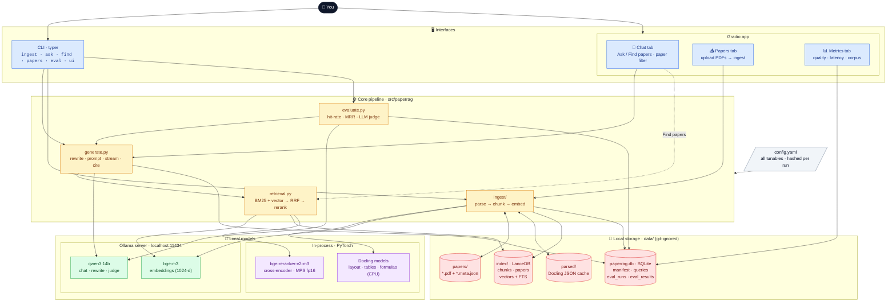
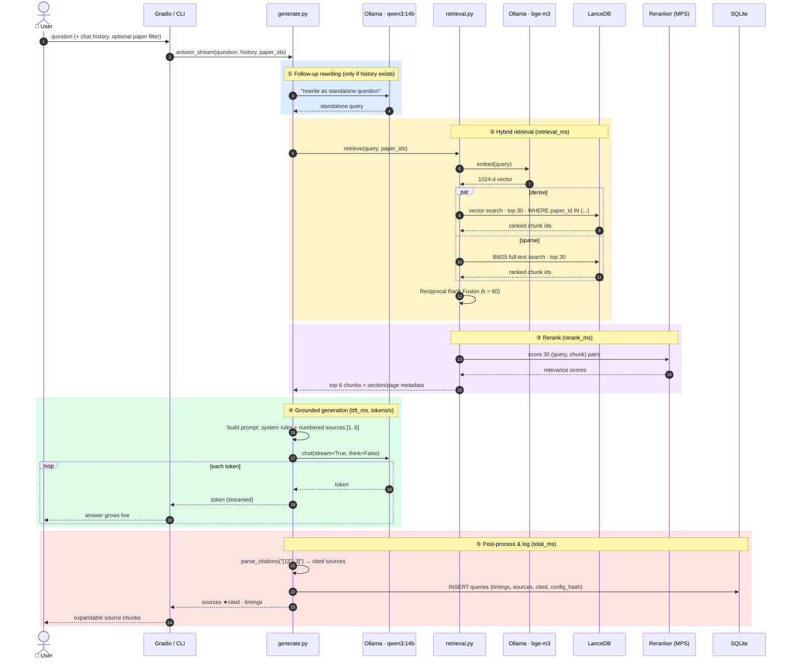
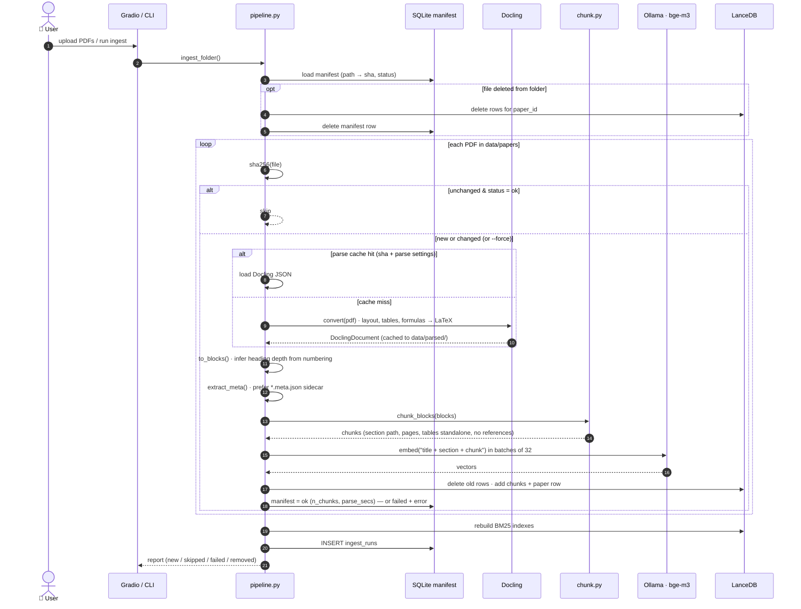
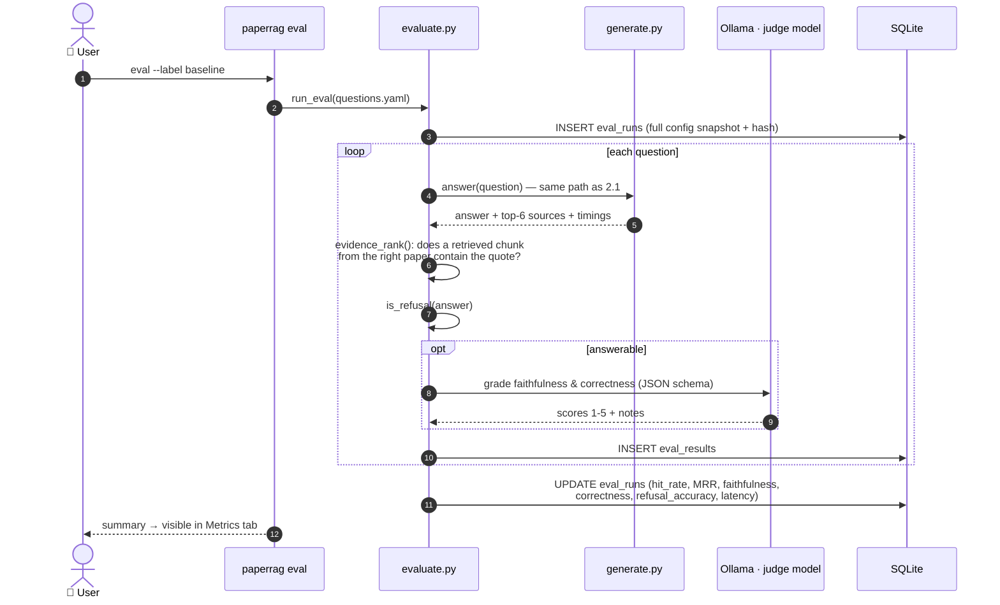

# PaperRAG — Architecture & Design Decisions

- [1. System architecture](#1-system-architecture)
- [2. Sequence diagrams](#2-sequence-diagrams)
  - [2.1 Asking a question](#21-asking-a-question)
  - [2.2 Ingesting papers](#22-ingesting-papers)
  - [2.3 Running the eval set](#23-running-the-eval-set)
- [3. Architectural & design decisions](#3-architectural--design-decisions)
- [4. Known limitations & open questions](#4-known-limitations--open-questions)

---

## 1. System architecture

Everything runs on one machine (Apple M4 Pro, 24 GB unified memory). Nothing leaves the
machine at query time; Hugging Face is only contacted once to download model weights.

| Colour | Layer |
|---|---|
| 🟦 Blue | Interfaces (CLI, Gradio tabs) |
| 🟨 Amber | Core pipeline modules |
| 🟩 Green | Models served by local **Ollama** |
| 🟪 Purple | Models running **in-process** (PyTorch) |
| 🟥 Red | Local storage under `data/` |

### Module map

| Module | Responsibility | Depends on |
|---|---|---|
| `config.py` | Typed config from `config.yaml`; `snapshot()` + `hash()` for experiment tracking | pydantic |
| `ingest/parse.py` | PDF → `Block`s + `PaperMeta`; caches Docling JSON by file hash + parse settings | Docling |
| `ingest/chunk.py` | **Pure** section-aware chunker (no I/O, fully unit-tested) | — |
| `ingest/pipeline.py` | Incremental ingest via hash manifest; embeds; writes store + log | parse, chunk, llm, store, db |
| `store.py` | LanceDB `chunks` and `papers` tables; vector + FTS search; deletes | LanceDB |
| `llm.py` | Ollama embed/chat (streaming + stats), cross-encoder rerank, warmup | ollama, sentence-transformers |
| `retrieval.py` | RRF fusion, hybrid retrieve, rerank, paper discovery | llm, store |
| `generate.py` | Follow-up rewrite, prompt versions, streaming answer, citation parsing, query logging | llm, retrieval, db |
| `evaluate.py` | Eval runner: evidence-quote hit-rate/MRR, LLM judge, run summaries | generate, llm, db |
| `db.py` | SQLite schema + helpers (manifest, queries, ingest/eval runs) | sqlite3 |
| `ui.py` | Gradio Blocks: Chat · Papers · Metrics | everything above |
| `cli.py` | typer entry point `paperrag` | everything above |

---

## 2. Sequence diagrams

### 2.1 Asking a question

Same path for CLI `ask` and the Gradio Chat tab (Ask mode). Every timing shown is
measured and written to the `queries` table, which feeds the Metrics tab.

### 2.2 Ingesting papers

Triggered by `paperrag ingest` or the **Upload & ingest** button (which first copies
uploaded PDFs into `data/papers/`).

### 2.3 Running the eval set

---

## 3. Architectural & design decisions

Each decision lists the options evaluated, what was chosen, and why. Decisions marked
🔬 came from measurements made while building, not from up-front planning.

### D1 · Hand-built pipeline, no RAG framework
| Options | (a) hand-built with thin libraries · (b) LlamaIndex / LangChain · (c) off-the-shelf app (Open WebUI, AnythingLLM) |
|---|---|
| **Chosen** | **(a)** |
| **Why** | The goal is learning. Every stage (chunking, fusion, reranking, prompting, evaluation) is a small, readable module. Frameworks hide exactly the parts worth understanding. |
| **Trade-off** | More code to own; no free integrations. Easy to compare against a framework later. |

### D2 · Fully local, Ollama for chat + embeddings
| Options | cloud APIs · Ollama · llama.cpp / MLX directly |
|---|---|
| **Chosen** | **Ollama** for the chat model and embeddings |
| **Why** | Privacy, no cost, offline. Ollama gives one HTTP API for both, model swapping by name in `config.yaml`, and Metal GPU acceleration. |
| **Trade-off** | Ollama doesn't serve cross-encoder rerankers well → see D9. |

### D3 · Chat model: `qwen3:14b`, thinking off, 8k context 🔬
| Options | ~8B (fast, weaker at citation discipline) · **~14B @ Q4 (~9 GB)** · ~30B (barely fits 24 GB, slow) |
|---|---|
| **Chosen** | `qwen3:14b`, `think: false`, `num_ctx: 8192` |
| **Why** | Best quality that runs comfortably (~16–21 tok/s measured). Thinking mode adds latency and pollutes streamed output; the prompt already constrains reasoning. |
| **Measured** | At `num_ctx: 16384` the model occupied **11 GB**. Six chunks + prompt ≈ 3–4k tokens, so 8k is ample and frees memory. |
| **Measured (latency)** | Generation ≈ **23 tok/s**, but prompt processing only ≈ **150 tok/s** (benchmarked with cache-defeating prompts). A typical prompt is ~3.3k tokens (6 chunks), so **time-to-first-token ≈ 20–30 s** dominates total latency. Ollama reuses the prompt cache for repeated prompts (0.1 s), which makes naïve benchmarks misleading. Levers: fewer/smaller chunks in context, or a smaller model. |

### D4 · PDF parsing: Docling
| Options | **Docling** · Marker · GROBID (Docker/Java) · PyMuPDF (plain text) |
|---|---|
| **Chosen** | **Docling**, OCR off |
| **Why** | Pure Python, runs on Apple Silicon, preserves section structure, exports tables as Markdown, can convert equations to LaTeX. Its structured output feeds the chunker directly. GROBID is better at bibliographic metadata, but we use arXiv sidecars for that (D7). |
| **Trade-off** | Slow and memory-hungry compared to PyMuPDF. OCR disabled because arXiv PDFs have text layers (scanned PDFs will fail and show in the dashboard). |

### D5 · Formula enrichment on, despite cost 🔬
| Options | skip equations · **LaTeX via Docling's CodeFormula model** |
|---|---|
| **Chosen** | On (`ingest.formula_enrichment: true`) |
| **Why** | Without it, formula items come out **empty** (measured). Equations matter for research Q&A. |
| **Measured** | RAG paper: **8 s → 70 s** per paper. The model doesn't support MPS (`AcceleratorDeviceNotAvailableError`), so it runs on CPU; device is set to `AUTO` so other Docling models still use the GPU. Mitigated by the parse cache (D6) — paid once per PDF. |

### D6 · Parse cache keyed by file hash + parse settings
| Options | re-parse on every ingest · **cache Docling JSON** |
|---|---|
| **Chosen** | `data/parsed/<sha256>-f<formula>.json` |
| **Why** | Chunk-size experiments require re-chunking. With the cache, `ingest --force` re-chunks and re-embeds in seconds instead of re-parsing for ~70 s per paper. Including parse settings in the key prevents stale caches when toggling formula enrichment. |

### D7 · Paper metadata: sidecar first, heuristics as fallback
| Options | LLM-extracted metadata · GROBID · **sidecar JSON + heuristics** |
|---|---|
| **Chosen** | `fetch_arxiv.py` writes `<id>.meta.json` (title, authors, year, abstract). Uploaded PDFs without a sidecar use heuristics: first page-1 heading = title, text under "Abstract", arXiv-ID or year regex. |
| **Why** | Exact metadata for free when known; no per-paper LLM call at ingest. |

### D8 · Section-aware chunker (own implementation)
| Options | fixed-size windows · Docling `HybridChunker` · **own section-aware chunker** |
|---|---|
| **Chosen** | Pure function `chunk_blocks()` |
| **Rules** | Never cross a section boundary · target 650 / max 800 tokens, ~80-token paragraph overlap · tables are standalone chunks (caption included) · reference list skipped, appendix kept · oversized paragraphs split on sentences · every chunk carries section path + page range. |
| **Why** | Section boundaries are semantic boundaries in papers; section paths make citations precise ("§2.2 Retriever: DPR, p. 3"); excluding references stops bibliography entries matching every query. Pure function → unit-tested without Docling. |
| 🔬 **Found while building** | Docling reports **every heading as level 1**, so depth is inferred from numbering (`2.1` → 2, `A.3` → 2). Early dedupe logic dropped legitimate chunks with identical text — replaced by explicit "fresh content" tracking (caught by tests). |

### D9 · Contextual chunk headers
| Options | embed raw chunk · **prefix "paper title + section path"** |
|---|---|
| **Chosen** | `embed_text = title \n section \n\n text` (used for both embeddings and BM25); raw `text` is what the LLM and UI see. |
| **Why** | A chunk saying "our model outperforms…" is unfindable without knowing which paper/section it belongs to. Cheap and well-established. |

### D10 · Vector store: LanceDB
| Options | **LanceDB** · Chroma · sqlite-vec · Qdrant (Docker) |
|---|---|
| **Chosen** | LanceDB (embedded, file-based) |
| **Why** | No server; native full-text (BM25) index next to vectors; SQL-style `WHERE` prefilters for the paper selector; scales far beyond a few hundred papers. Two tables: `chunks` and `papers`. |

### D11 · Hybrid search with our own RRF
| Options | vector only · LanceDB built-in hybrid · **separate BM25 + vector, fused by own RRF** |
|---|---|
| **Chosen** | Two searches (30 candidates each), fused with Reciprocal Rank Fusion, `k = 60` |
| **Why** | Research text is full of exact tokens (LoRA, BLEU, ResNet-50, dataset names) that dense embeddings blur. RRF needs no score calibration between BM25 and cosine. Implementing it (10 lines, unit-tested) is part of the learning; `retrieval.hybrid: false` toggles it for eval comparison. |

### D12 · Cross-encoder reranker, in-process 🔬
| Options | no rerank · Ollama (poor support) · **sentence-transformers CrossEncoder on MPS** |
|---|---|
| **Chosen** | `BAAI/bge-reranker-v2-m3`, 30 → top 6, fp16 on MPS, switchable (`use_reranker`) |
| **Why** | Bi-encoder + BM25 recall well but rank coarsely; a cross-encoder reads query and chunk together. |
| **Measured** | ~3 s per query warm (fp32), 13 s cold; 3.5–5 s warm in fp16 on the full 19-paper index. Changes: fp16 on MPS, and `warmup()` at UI/eval start so model-load time doesn't pollute latency metrics. Remains the slowest retrieval stage → candidate for tuning (fewer candidates, smaller reranker). |

### D13 · Embeddings: `bge-m3` via Ollama
| Options | **bge-m3** · nomic-embed-text · qwen3-embedding |
|---|---|
| **Chosen** | bge-m3 (1024-d, long input, strong on technical text) — configurable |
| **Why** | Good quality/size trade-off and already in Ollama. Changing it requires `ingest --force`. |

### D14 · Grounded-only answers, versioned prompts 🔬
| Options | allow model knowledge · **sources only, explicit refusal** |
|---|---|
| **Chosen** | Model must cite `[n]` for every claim and reply exactly *"I couldn't find this in your papers."* when unsupported. Prompts are versioned (`generation.prompt_version`). |
| **Why** | Research answers must be verifiable. A fixed refusal string makes refusal measurable in eval. |
| **Measured** | Prompt **v1** leaked outside knowledge on mixed questions ("…8×32GB V100s [2]. The capital of France is Paris **[1]**" — even with a fake citation). **v2** (stricter system-prompt wording) leaked identically. **v3** = v2 + the rules repeated *after* the sources in the user message: 3/3 mixed or off-topic probes handled correctly ("…100 passages [1]. The sources do not cover who won the 2018 World Cup."). Lesson: with a 14B model, *where* an instruction sits matters more than how forcefully it is worded. Pending confirmation on the full eval set (D18). |

### D15 · Citations: inline `[n]` + expandable source chunks
| **Chosen** | Numbered sources in the prompt; `parse_citations()` handles `[1]`, `[1, 3]`, `[2-4]`, `[1][2]`, ignores out-of-range numbers. The UI marks cited sources with ★ and shows the exact chunk text. |
|---|---|
| **Why** | You can check every claim against the actual passage, and the dashboard can count citation use. |

### D16 · Multi-turn chat via query rewriting
| Options | stateless questions · pass full history to retrieval · **rewrite follow-up into standalone query** |
|---|---|
| **Chosen** | If history exists, one non-streamed LLM call rewrites the question; the rewritten query is shown in the UI and logged. |
| **Why** | "What about their ablations?" retrieves nothing useful on its own. Rewriting keeps retrieval stateless and debuggable. Cost: one extra LLM call per follow-up (`rewrite_ms`). |

### D17 · Paper discovery = fused paper index + chunk evidence
| Options | chunk search only · LLM-written summaries per paper · **title+abstract index fused with chunk hits** |
|---|---|
| **Chosen** | "Find papers" fuses (a) hybrid search over a one-row-per-paper index and (b) papers ranked by their best chunk, via RRF; shows the best matching chunk as evidence. |
| **Why** | Abstract-level matching catches a paper's main topic; chunk-level matching catches topics discussed in passing. LLM summaries would add minutes per paper at ingest. |

### D18 · Evaluation: evidence quotes, two kinds of metrics, config snapshots
| **Chosen** | `eval/questions.yaml` with `(paper filename, verbatim quote)` as evidence, plus unanswerable questions. Metrics: **hit-rate@6, MRR** (deterministic), **faithfulness & correctness** (LLM judge, JSON-schema output, normalised to 0–1), **refusal accuracy**. Each run stores the full config snapshot + hash. |
|---|---|
| **Why** | Chunk ids change whenever chunking changes; quotes don't — the same eval set stays valid across chunking experiments. Deterministic retrieval metrics are trustworthy; judge scores are noisy but show trends when the judge prompt is fixed. Config snapshots let the dashboard attribute a metric change to a setting. |
| **Caveat** | Same model as generator and judge → self-preference bias. `models.judge` is configurable. |

### D19 · Observability: one SQLite file + Gradio Metrics tab
| Options | Grafana / Prometheus · MLflow · **SQLite + Plotly inside Gradio** |
|---|---|
| **Chosen** | Tables `manifest`, `ingest_runs`, `queries`, `eval_runs`, `eval_results` in `data/paperrag.db`. |
| **Why** | Zero extra services; queryable with plain SQL; the same file holds the ingest manifest. The Metrics tab shows eval quality per run, latency breakdown per config, tokens/s, and corpus health (papers, chunks, failures). |

### D20 · Incremental ingestion by content hash
| **Chosen** | SHA-256 manifest. Unchanged → skip; changed → delete old rows, re-ingest; deleted file → removed from index. Failures are recorded, not fatal. BM25 indexes rebuilt after changes. |
|---|---|
| **Why** | Parsing is the slowest step; re-processing hundreds of PDFs on every upload would be unusable. |

### D21 · Interfaces: CLI + Gradio (chat, upload, metrics)
| **Chosen** | One core library; a typer CLI for fast iteration and scripting; a Gradio app with Chat (streaming, paper filter, Ask/Find modes), Papers (upload → ingest), and Metrics tabs. |
|---|---|
| **Why** | The CLI is the quickest loop for development; the UI is better for reading answers and sources. Both call identical functions, so behaviour and metrics match. |

### D22 · Memory budget on 24 GB 🔬
| **Observed** | Running ingestion (Docling + formula model) while the 14B chat model was loaded pushed the machine to **15 GB of swap** and stalled ingestion. |
|---|---|
| **Decision** | Don't run heavy ingestion and chat at the same time on this machine; unload the chat model (`ollama stop qwen3:14b`) for bulk ingests. Reduced `num_ctx` (D3). Uploading a few papers from the UI is fine. |

### D23 · Tooling: uv, Python 3.12, pytest on pure functions
| **Chosen** | uv-managed project pinned to Python 3.12 (system Python 3.14 is too new for parts of the PyTorch/Docling stack). Unit tests cover the deterministic core: chunking, RRF, citation parsing, metadata heuristics, evidence matching. LLM outputs are evaluated by the eval set, not unit tests. |

---

## 4. Known limitations & open questions

- **Figures are ignored** (no vision model). Figure captions are indexed as text.
- **Scanned PDFs fail** (OCR off). They appear under "Failed files" in the dashboard.
- **Token counts are estimated** (~1.3 × words), not exact model tokenizer counts.
- **Time-to-first-token (~20–30 s)** is the largest latency cost: prompt processing at ~150 tok/s × ~3.3k tokens.
- **Wrong-paper attribution**: "the RAG authors" can be answered from a chunk of a *different* paper; chunk labels name the paper, but the model doesn't always respect them.
- **Reranker latency** is the largest retrieval cost; try `candidates: 15` or a smaller reranker and compare in eval.
- **Inline math inside paragraphs** is plain text; only display equations are converted to LaTeX.
- **Self-judging bias**: the judge is the same model as the generator by default.
- **Cross-paper synthesis** ("compare these 5 papers") works only as far as the top-6 chunks allow; per-paper retrieval quotas are a natural next step.
